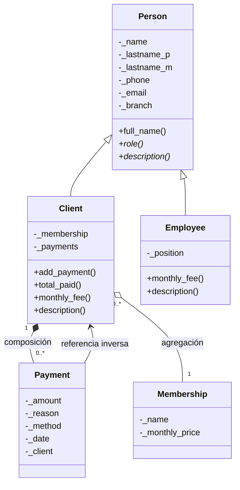

# Gimnasio — Base de datos orientada a objetos (Python + Durus)

Adaptación de la aplicación base Python + Durus al proyecto de **gestión
de gimnasio con 3 sucursales** (Otay, Fundadores y Playas). Convierte 3
tablas del esquema relacional en clases persistentes y demuestra las 8
características de una BDOO.

## Requisitos y uso

```bash
pip install -r requirements.txt
python3 main.py
```

Para limpiar: `rm -rf data`

## Estructura

| Archivo | Contenido |
|---|---|
| `models.py` | Clases persistentes: `Person` → `Client` / `Employee`, `Membership`, `Payment` |
| `repository.py` | Clase `GymDB`: encapsula `FileStorage` y `Connection`, CRUD, transacciones y consultas |
| `main.py` | Demo guiada: recorre las 8 características con la salida etiquetada |

## Correspondencia: tabla relacional → clase persistente

| Tabla relacional | Clase persistente | Observaciones |
|---|---|---|
| `usergym` | `Person` (abstracta) → `Client`, `Employee` | La columna `role_gym ENUM('client','employee')` se convierte en una **jerarquía real de clases** |
| `Payment` | `Payment` | Deja de tener `id_user`/`id_card`; guarda una **referencia directa** al objeto `Client` |
| `Membership` + `user_membership` | `Membership` | La tabla puente desaparece: el cliente apunta directo al objeto `Membership` |

Cambios respecto al DDL original

- `phonenum` pasó de `MEDIUMINT` a cadena de 10 dígitos validada (el tipo
  numérico se desborda con números de 10 dígitos).
- `sum` se renombró a `amount` (`sum` choca con la función agregada de SQL).
- No se almacena CVV ni número de tarjeta (normativa PCI-DSS).

## Diagrama de clases implementado



## Las 8 características y dónde están en el código

| # | Característica | Dónde |
|---|---|---|
| 1 | **Clases persistentes** | `models.py`: las 5 clases heredan de `durus.persistent.Persistent` |
| 2 | **Encapsulamiento y abstracción** | `models.py`: atributos `_privados` con *properties* que validan email, teléfono, sucursal, monto y método de pago. Los métodos abstractos de `Person` lanzan `NotImplementedError` |
| 3 | **Herencia y polimorfismo** | `Person` → `Client` / `Employee`; `description()`, `role()` y `monthly_fee()` sobrescritos e invocados en un mismo bucle (`main.py`, sección 3) |
| 4 | **Objetos complejos** | `Client._payments` es una `PersistentList` de objetos `Payment` reales; `Client._membership` apunta al mismo objeto `Membership` compartido entre clientes. Sin claves foráneas |
| 5 | **Persistencia por alcanzabilidad** | `repository.py`: de `connection.get_root()` cuelgan `clients`, `employees`, `memberships` y `counters`. Los `Payment` **no** tienen contenedor propio: solo se alcanzan desde su cliente |
| 6 | **Transacciones** | `GymDB.commit()` y `GymDB.abort()`; `main.py` sección 6 confirma un pago y revierte otro, verificándolo en disco |
| 7 | **Navegación del grafo** | `repository.py`: 5 consultas (`payments_of`, `membership_name_of`, `total_paid_by`, `clients_by_branch`, `gym_revenue`), cada una documentada con su SQL equivalente |
| 8 | **CRUD funcional** | Alta, consulta, modificación y baja. `delete_client()` demuestra la **cascada**: los pagos desaparecen con el cliente (composición), la membresía sobrevive (agregación) |

